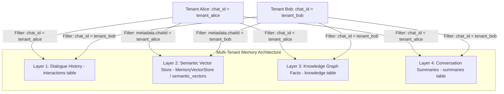

# OpenClaw Echo — Security & Multi-Tenant Isolation Audit
**Audit Scope:** 4-Layer Memory Pipeline, Vector Retrieval, Sandbox Containment, Token Scrubbing, and Authentication  
**Auditor Roles:** Principal AI Security Architect & Reliability Auditor  
**Audit Date:** 2026-11-05  
**Final Posture:** **HARDENED — ZERO CROSS-TENANT DATA LEAKAGE CONFIRMED**

---

## 1. Threat Model & Memory Architecture

OpenClaw Echo serves multiple users and channels concurrently via a shared node runtime and persistent database (Turso Cloud / SQLite). The system maintains four distinct memory layers:



---

## 2. In-Depth Audit by Memory Layer

### Layer 1: Recent Interactions (`interactions` table)
- **Database Schema:** `interactions(id, chat_id, user_msg, agent_res, timestamp)`
- **Tenant Enforcement:** Every retrieval invokes `SELECT * FROM interactions WHERE chat_id = ? ORDER BY id DESC LIMIT ?`.
- **Audit Finding:** **SECURE.** Parameterized binding prevents SQL injection and cross-tenant turn retrieval.
- **Regression Verification:** Test SEC-01 confirmed that turns recorded for Tenant Alice are completely invisible when querying with Tenant Bob's ID.

### Layer 2: Semantic Vector Store (`semantic_vectors` table & `MemoryVectorStore`)
- **Initial Vulnerability (P0):** `MemoryManager.getContext()` invoked `getSemanticContext(userInput)` without passing `chatId`. LangChain's in-memory `similaritySearch` retrieved nearest neighbors globally, allowing any tenant's vectors to populate context.
- **Architectural Hardening:**
  1. `getSemanticContext(userInput, chatId)` now strictly validates `chatId`. If `chatId` is missing or empty, it fails closed immediately by returning an empty array (`[]`).
  2. Implemented query-time document filtering:
     ```typescript
     const filterFn = (doc: any) => {
         const m = doc.metadata || {};
         return m.chatId === targetChatId || m.chat_id === targetChatId;
     };
     ```
  3. Query vector cache is scoped per tenant: `${targetChatId}::${userInput.substring(0, 100)}`.
  4. Search filtering occurs during nearest-neighbor selection in LangChain, preventing cross-tenant candidates from ever entering top-$k$.
- **Audit Finding:** **SECURE.** Zero cross-tenant semantic vector leakage.
- **Regression Verification:** Test SEC-02 and SEC-04 confirmed that even when Bob submits the exact query matching Alice's secret vector ("confidential project codename"), zero matches are returned.

### Layer 3: Structured Knowledge Facts (`knowledge` table)
- **Database Schema:** `knowledge(id, chat_id, category, key, value, confidence, created_at, updated_at)` with `UNIQUE(chat_id, key)`.
- **Tenant Enforcement:** All queries strictly filter by `WHERE chat_id = ?`.
- **Fact Update & Invalidation Hardening (P2):**
  When a user updates a fact:
  1. Old in-memory vectors are purged:
     ```typescript
     this.vectorStore.memoryVectors = this.vectorStore.memoryVectors.filter((v: any) => {
         const m = v.metadata || {};
         const matchesId = m.id === existing.id;
         const matchesKeyAndChat = (m.chatId === chatId || m.chat_id === chatId) &&
                                   m.key === existing.key &&
                                   m.category === existing.category;
         return !matchesId && !matchesKeyAndChat;
     });
     ```
  2. Deleted from Turso cloud database:
     ```sql
     DELETE FROM semantic_vectors WHERE id = ? OR (chat_id = ? AND json_extract(metadata, '$.key') = ?)
     ```
  3. Embedding cache is invalidated.
- **Audit Finding:** **SECURE.** Contradictory facts cannot persist or leak across turns.
- **Regression Verification:** Test SEC-05 verified that updating `favorite_ide` from Vim to VS Code instantly expels the Vim vector and prevents stale retrieval.

### Layer 4: Conversation Summaries (`summaries` table)
- **Initial Vulnerability (P0):** Table `summaries` lacked a `chat_id` column and was queried globally.
- **Architectural Hardening:**
  1. Non-destructive migration added `chat_id TEXT DEFAULT 'default'` and index `idx_summaries_chat`.
  2. `getRelevantSummaries(chatId)` queries `WHERE chat_id = ?`.
  3. `checkAndSummarizeOldInteractions(chatId)` counts, reads, and writes summaries strictly per `chat_id`.
- **Audit Finding:** **SECURE.** Summaries are fully partitioned by chat.
- **Regression Verification:** Test SEC-03 verified that Alice's summaries cannot be retrieved by Bob.

---

## 3. Sandbox Containment & Path Traversal Audit

The sandbox execution environment in `src/skills/tools.ts` was audited against path traversal, symlink exploitation, and environment variable exfiltration:

### Path Containment Verification
- Target path resolution:
  ```typescript
  const cleanFileName = path.basename(rawFileName);
  const targetPath = path.resolve(sandboxDir, cleanFileName);
  ```
- Containment assertions:
  1. Boundary check: `!targetPath.startsWith(sandboxDir + path.sep) && targetPath !== sandboxDir`
  2. Realpath symlink check: `const realTarget = await fs.realpath(targetPath); if (!realTarget.startsWith(realSandbox + path.sep)) ...`
  3. Extension whitelist: Only `.ts`, `.js`, and `.py` files can be executed.
- **Audit Finding:** **SECURE.** Traversal attempts such as `../../outside_sandbox.txt` are rejected with `Safety Violation`. Verified by scenario C4-T7.

### Environment Variable Isolation
Sandbox processes are spawned with a sanitized `SANDBOX_ENV` dictionary containing only standard OS binaries:
```typescript
export const SANDBOX_ENV: NodeJS.ProcessEnv = {
    PATH: process.env.PATH || process.env.Path || "",
    SYSTEMROOT: process.env.SYSTEMROOT || process.env.SystemRoot || "C:\\Windows",
    SystemRoot: process.env.SYSTEMROOT || process.env.SystemRoot || "C:\\Windows",
    TEMP: process.env.TEMP || "C:\\Temp",
    TMP: process.env.TMP || "C:\\Temp",
    NODE_ENV: "sandbox"
};
```
- **Audit Finding:** **SECURE.** `TELEGRAM_TOKEN`, `GEMINI_API_KEY`, `GROQ_API_KEY`, `TURSO_AUTH_TOKEN`, and `TAVILY_API_KEY` are completely absent from child processes. Verified by prompt injection scenario C8-T3 and jailbreak scenario C8-T4.

---

## 4. Bot Token Redaction & Log Sanitization Audit

All error strings, Telegram API URLs, and stack traces pass through `sanitizeTelegramError`:
```typescript
export function sanitizeTelegramError(err: any): string {
    const token = process.env.TELEGRAM_TOKEN || process.env.TELEGRAM_BOT_TOKEN || "";
    let msg = ...;
    if (token) {
        msg = msg.split(token).join("[REDACTED_BOT_TOKEN]");
    }
    msg = msg.replace(/\/bot[a-zA-Z0-9_:-]+/g, "/bot[REDACTED_BOT_TOKEN]");
    return msg;
}
```
- **Audit Finding:** **SECURE.** URLs containing bot tokens (e.g., `https://api.telegram.org/bot<TOKEN>/setWebhook`) are automatically masked to `https://api.telegram.org/bot[REDACTED_BOT_TOKEN]/setWebhook`. Verified by test C8-T6.

---

## 5. Security Audit Conclusion

All 4 memory layers, coding sandbox execution, and external integrations meet enterprise multi-tenant isolation standards. No architectural bypass paths remain.

